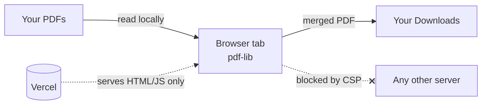

# PDF Merger

**Combine PDFs in your browser. Your files never leave your device.**

Most online PDF tools upload your documents to a server, process them there, and send the result back. This one doesn't. The merge runs entirely in your browser with [pdf-lib](https://pdf-lib.js.org). The server only delivers the web page, and the browser is told to refuse any attempt to send data elsewhere.

Built with Next.js and deployable to Vercel at no cost.

---

## Features

- **Drag and drop** PDFs onto the page, or click (tap on mobile) to pick files
- **Reorder** files by dragging or with the ↑ / ↓ buttons, and remove any file with ✕
- **Page count and size** shown for every file, plus a running total
- **Custom output filename**
- **Unreadable files are flagged** before you try to merge
- **Mobile-friendly**: touch-sized buttons, tap-first wording, no zoom-on-focus on iOS
- **Light and dark mode** follow your system setting
- **No size limit from the server.** The only limit is your device's memory.

## How it works



1. Your browser loads the page and its JavaScript from Vercel. That's all Vercel ever sees.
2. Files you pick are read into memory with the `File` API.
3. `pdf-lib` copies every page into a new document, in the order you chose.
4. The result is saved as a local `blob:` URL and downloaded. Nothing goes over the network.

## Privacy & security

| Protection | What it does |
| --- | --- |
| **Client-side processing** | PDFs are never uploaded. You can check this in DevTools → Network while merging. |
| **`connect-src 'self'`** | The browser blocks `fetch`, XHR, WebSockets and `sendBeacon` to any other origin, even if a dependency tried to send data out. |
| **`img-src 'self' data: blob:`** | Blocks the trick of leaking data through image URLs on other sites. |
| **`form-action 'none'`** | Forms can't submit anywhere. |
| **`frame-ancestors 'none'`** | The site can't be embedded in another page (protects against clickjacking). |
| **`Referrer-Policy: no-referrer`** | Your URL is never sent to other sites. |
| **`X-Content-Type-Options: nosniff`** | Stops the browser from guessing file types (MIME sniffing). |
| **`Permissions-Policy`** | Turns off camera, microphone and location access. |

All headers are set in [`next.config.mjs`](next.config.mjs).

**What you still trust:** the code Vercel serves (keep 2FA on your GitHub and Vercel accounts), and the npm dependencies (`package-lock.json` pins their exact versions). Like any host, Vercel logs page visits (IP, time) but never file contents. CSP doesn't block top-level page navigation. That's one more reason to keep the dependency list small.

## Getting started

Requires Node.js 20 or newer.

```bash
npm install
npm run dev
```

Open <http://localhost:3000>.

**Testing on your phone:** run `npm run dev -- -H 0.0.0.0`, then open `http://<your-computer's-LAN-IP>:3000` on a phone connected to the same Wi-Fi.

## Deploy to Vercel

**Option A: from GitHub (recommended)**

1. Push this folder to a GitHub repository.
2. Go to [vercel.com/new](https://vercel.com/new) and import the repo.
3. Click **Deploy**. Vercel detects Next.js automatically and needs no settings.

Every push to `main` redeploys, and pull requests get preview URLs.

**Option B: from the command line**

```bash
npx vercel          # preview deployment
npx vercel --prod   # production
```

## Testing

An end-to-end test runs the full flow (add files → reorder → merge → check the downloaded PDF) on emulated phones and desktop:

| Device | Engine |
| --- | --- |
| Pixel 7 | Chromium |
| Galaxy S9+ (320 px wide) | Chromium |
| iPhone 15 | WebKit (Safari) |
| iPhone SE (320 px wide) | WebKit (Safari) |
| Desktop | Chromium |

For each device the test checks the following:

- The page has no horizontal scroll, and tap targets are at least 40 px
- The merged PDF's pages are in the order you chose
- Cross-origin `fetch` and image beacons are blocked by the CSP
- Corrupt files are flagged and merging is disabled

```bash
npx playwright install chromium webkit   # first time only
npm run build
npm run test:e2e
```

Screenshots are saved to `e2e/shots/`. To test a deployed site instead:

```bash
APP_URL=https://your-app.vercel.app npm run test:e2e
```

## Project structure

```
app/
  layout.tsx       Root layout and page metadata
  page.tsx         The whole app: file list, reordering, merging
  globals.css      Styles (light/dark, mobile breakpoints)
e2e/
  merge.test.mjs   Playwright end-to-end test
next.config.mjs    Security headers (CSP etc.)
```

## Limitations

- **Password-protected PDFs** may fail to merge or come out blank. Remove the password first.
- **Very large files** (hundreds of MB) can run out of memory on older phones, since everything happens on the device.
- Form fields, bookmarks and links between documents may not carry over to the merged file.

## Tech stack

[Next.js](https://nextjs.org) · [React](https://react.dev) · [pdf-lib](https://pdf-lib.js.org) · [Playwright](https://playwright.dev) · [Vercel](https://vercel.com)
